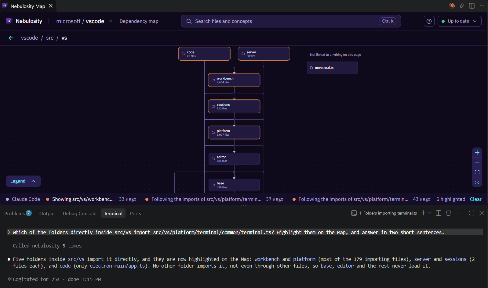
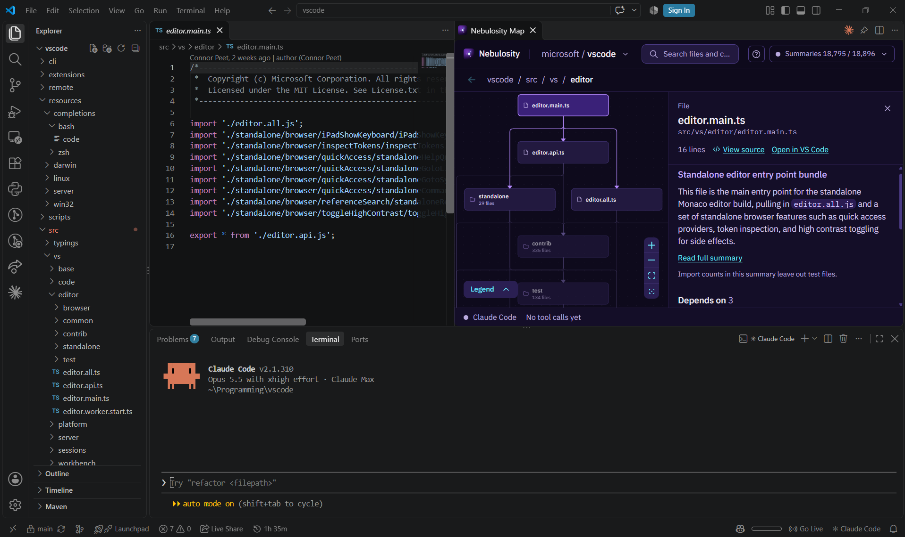

# Nebulosity

**A live map of how a big codebase fits together, for Claude Code and for you.**

[nebulosity.ca](https://nebulosity.ca) · [Live Demo](https://demo.nebulosity.ca) (the Map on VS Code's own source, with nothing to install)

In a large codebase, some questions take many steps to answer. To find out what a change to one file could affect, you need every file that imports it, then every file that imports those, and so on. Claude Code normally works this out with one search after another. The VS Code repository has 14,849 files and over 140,000 imports, so a question like this can take a lot of searches.

Nebulosity indexes all of a repository's imports ahead of time and keeps the index up to date as you work. Claude Code can then answer the whole question with a single tool call. In my tests, Claude Code with Nebulosity answered questions like this **up to 4.4× faster**, and up to 3.7× faster\* on a codebase I never adjusted Nebulosity for. It got every one of them right.

You can also explore these imports yourself on the Map, which shows your codebase one folder at a time, with lines showing what imports what. The Map opens in your browser or in a VS Code panel.


## Evaluation

I gave Claude Code the same questions with and without Nebulosity on three large open-source TypeScript codebases, VS Code, AFFiNE and Theia, and checked all 378 runs' answers against reference answers prepared without it. I never adjusted Nebulosity for Theia, so Theia is the fairest test of the three.

Nebulosity helped most when the answer meant following imports through several files, like working out what a change to one file could affect, how an entry point ends up loading another file, or whether a file is part of an import cycle. There were 14 questions like these, each asked 3 times with Nebulosity and 3 times without. Depending on the type of question, Claude Code with Nebulosity was **2.3–4.4× faster** on VS Code and AFFiNE and **1.5–3.7× faster**\* on Theia, and usually cheaper too, by 1.4–2.6× on VS Code and AFFiNE and up to 1.3× on Theia. With Nebulosity it got all 42 answers fully right. Without it, 29 were fully right and the rest partly right. To trace how one file ends up loading another, it used one tool call every time and took a median of 5–6 seconds, against three to six calls and 16–24 seconds without.

On simpler questions, like listing the files that import a given file directly, Nebulosity made little difference, because one search already answers them. I split the questions into these two groups after the runs. [docs/EVALUATION.md](docs/EVALUATION.md) has the method, the caveats and the data behind every number.

\* The test didn't ask "what would changing this file affect?" on Theia, so I measured it later, on 26 October 2026, with the same setup. It came out 3.7× faster, with all 3 answers fully right with Nebulosity and none of 3 without. Those 6 runs aren't in the 14 questions above, and their data is in [eval3-theia-impact/](eval3-theia-impact/).

## Quick start

You'll need Node 24 or later and git, plus Claude Code 2.1.300 or later if you want the tools.

```bash
npm install -g nebulosity
```

Then run these from your repo's root folder.

```bash
nebulosity index .    # read the repo's files and imports (free; a minute or two for VS Code)
nebulosity map        # open the Map at http://localhost:3000 (it keeps running)
nebulosity setup      # in a second terminal in the same folder, connect Claude Code to this repo
```

That's it. Here are some things to ask Claude Code.

- "If I change `src/base/event.ts`, what could break?"
- "How does `main.ts` end up loading `terminal.ts`?"
- "Which entry points load this file?"
- "Are there import cycles in `src/platform`?"

It'll use Nebulosity's tools when they help, and it can point things out on the Map while it explains. If something seems off, `nebulosity doctor` will tell you what's missing.



## Features

The **Map** shows your repo one folder at a time, with at most 50 boxes on screen, so it stays readable. Click a box to see what it imports and what imports it, open its source, or search with Ctrl K. It updates as you save files.

The **seven tools** Claude Code gets are `overview`, `describe`, `search`, `imports`, `architecture`, `calls` and `show_on_map`. [The guide](docs/GUIDE.md#the-seven-tools) explains what each one does.

The **VS Code extension** puts the Map in a panel next to your code ([more below](#vs-code-extension)).

It reads **seven languages**, TypeScript and JavaScript (using TypeScript's own compiler) plus Python, Go, Java, C# and Rust ([how each one is read](docs/GUIDE.md#languages)).

And it's **free**. Everything above works without an API key, and Nebulosity itself never sends anything off your machine. AI-written summaries are an optional extra ([below](#ai-summaries-optional)).

## VS Code extension

The extension shows the Map beside your code. It follows whatever file you have open, opens a file when you click it on the Map, and can light up the files that import the one you're looking at.



1. Install the `nebulosity` package and index your repo (see above).
2. Install the **Nebulosity** extension from the [Marketplace](https://marketplace.visualstudio.com/items?itemName=andrewl746.nebulosity-vscode) or [Open VSX](https://open-vsx.org/extension/andrewl746/nebulosity-vscode), or run `code --install-extension andrewl746.nebulosity-vscode` in a terminal.
3. Run **Nebulosity: Show Map** from the Command Palette.

There's more in [vscode-extension/README.md](vscode-extension/README.md).

## AI summaries (optional)

With an Anthropic API key, `nebulosity summarize .` writes a short summary of every file and folder. You'll see them in the Map's details panel and in Nebulosity's answers to Claude Code, and search can find files by what they do, not just by the words in them.

This sends your code to Anthropic, since that's how the summaries get written. It costs about $1 per 1,000 files ($10.30 for all of VS Code). It shows you an estimate and waits for a yes before spending anything, and it stops once a repo has spent $15 in total, unless you raise the limit with `--budget`.

To add a key, [create one in the Claude Console](https://platform.claude.com/docs/en/get-api-key), then save the line `ANTHROPIC_API_KEY=sk-ant-...` in a file named `.env.local` in [Nebulosity's data folder](docs/GUIDE.md#the-commands), or set `ANTHROPIC_API_KEY` in your terminal. `nebulosity doctor` tells you once it finds the key. If the Map is already open, restart it so it picks the key up. Keep the key private, and never commit it.

[The guide](docs/GUIDE.md#summaries) has the rest, including which models write the summaries and [how to switch them](docs/GUIDE.md#summary-models).

## Architecture


`nebulosity index` reads your repo once and writes down every file, import and folder in a SQLite database on your machine. From then on, everything works from that index. When Claude Code asks a question, the MCP server answers from it, and the Map draws from the same data. While the Map is open, a background worker watches for saves and updates the index as you go, so neither one falls behind. And every time Claude Code uses one of Nebulosity's tools, the Map lights up what it's looking at.

All of it runs on one engine in `lib/`. The MCP server, the Map and the static demo are thin layers on top. Nebulosity has over 2,600 automated tests, which run in CI on Windows, macOS and Linux.

To dig deeper, start with these two docs.

- [docs/GUIDE.md](docs/GUIDE.md) covers every command and setting.
- [docs/BENCHMARKS.md](docs/BENCHMARKS.md) has the speed, accuracy and cost measurements.

## Background

I wanted to understand how AI agents and retrieval actually work, so I built every layer a tool like this needs. That meant an indexer for seven languages, an import graph that stays current as you edit, AI-written summaries, local embeddings, hybrid search, an MCP server for Claude Code to call, and the Map and the VS Code extension on top. Then I put it to the test with three evals and 738 runs of Claude Code with and without it, and every transcript is in the repo.

I also kept running into the problem myself. Every time I opened a big unfamiliar repo, my first questions had answers that weren't in any one file.

## License

MIT ([LICENSE](LICENSE)). The demo's data comes from [VS Code](https://github.com/microsoft/vscode) at commit `cc3fec88` (MIT, © Microsoft Corporation).
