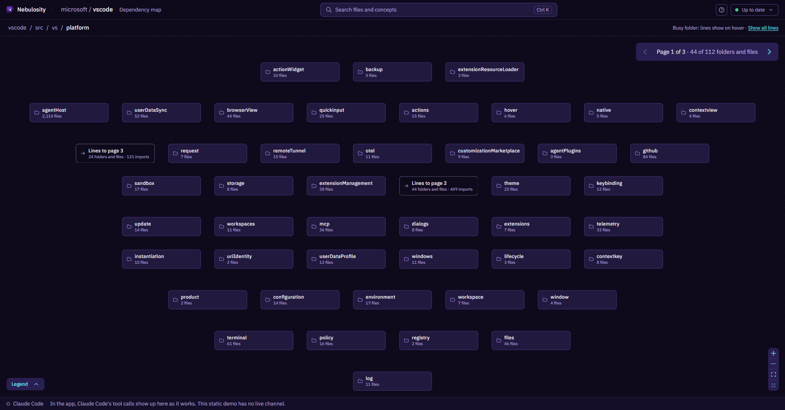

# Nebulosity

**Nebulosity is the dependency-structure layer for Claude Code.** It indexes every import in a big repo (TypeScript and JavaScript, and since E4 also Python, Go, Java, C# and Rust: [Languages](#languages)), keeps that index current as files change, and answers in one call the questions that take many steps over those imports. What would a change to this file affect, directly, through other files and in which areas? How does this entry point come to load that file? Which entry points load it? Where are the import cycles? In Eval #3, on those questions, Claude Code with Nebulosity answered 2.3–4.4 times as fast as Claude Code alone on VS Code and AFFiNE, and 1.5–3.2 times as fast on Theia, a repo held out from all tuning, at the same or a higher score. It cost 1.4–2.6 times less on VS Code and AFFiNE, and 1.0–1.3 times less on Theia. All three are TypeScript repos: for the five languages added since, only the index itself was measured.

**Elsewhere the gains were small or none.** Listing a method's callers took 0.57–0.66 of the time on VS Code and Theia, where the `calls` tool found nearly all of them, and 0.88–0.93 on AFFiNE, where it missed most of them. What a signature change touches, lists of direct importers, planning a change and questions about how a repo is designed came out about even, and some cost more. Eval #3's ship gate was set before its first run and aimed at the call questions; it failed on four of seven conditions. The question kinds above were grouped after the runs. How they were grouped, and every loss: [How it compares with Claude Code alone](docs/EVAL_RESULTS.md).

Nebulosity shows the same index to people as a zoomable Map: one folder at a time, lines for imports, and a panel with what each file uses and what uses it. It also has `calls`, for calls through injected services, and a search, and, with an Anthropic API key, it writes a summary of every file and folder. These help you find your way around a repo. In Eval #3, `calls` helped only with listing callers, and the summaries and search made no clear difference to Claude Code's big-picture answers. The Map is for people and wasn't measured.



## Why

Some questions about a big repo are walks over its import graph, many steps long. What depends on this file, directly or through other files? How does this entry point end up loading that file? In Eval #2, Claude Code on its own answered them by writing its own import-walking scripts or following imports with grep, a median 6 turns a question, against 2 with Nebulosity; in Eval #3, with its scripts no longer refused, 5 against 3. Nebulosity reads every import once, keeps the graph current while the Map runs, and answers such a question in one call. It plugs into Claude Code instead of replacing it: Claude Code still reads the code and writes the answer. The same index draws the repo for people, one folder at a time.

## What it does

- **The Map**: one folder at a time, at most 50 boxes, lines for imports between them; big folders split into pages of related boxes; a panel with each box's summary, contents, what it uses and what uses it; a read-only source viewer; search with Ctrl K.
- **Seven MCP tools for Claude Code**: `overview`, `describe` (with the docs about a place), `search`, `imports` (dependents, dependencies, what a change affects, import chains), `architecture` (layers, conventions, cycles, files nothing imports), `calls` (who calls a method, even through injected services, and what changing it touches) and `show_on_map`.
- **Seven languages**: TypeScript and JavaScript through TypeScript's own compiler; Python, Go, Java, C# and Rust through tree-sitter, each resolved by its own language's rules ([Languages](#languages)). `calls` reads TypeScript and JavaScript only.
- **Fresh**: while the Map runs, a background worker reflects a saved file in 1.5 s at worst once warm (Update Benchmark #3) and, with a key, refreshes its summary after a quiet minute.
- **In VS Code**: an extension shows the Map in a panel beside the code, following the file you're in; a file picked on the Map opens in the editor ([below](#in-vs-code); not yet published).

## How it compares with Claude Code alone

**Eval #3 (2026-10-16).** Claude Code answered 61 questions about three big repos, VS Code, AFFiNE and Theia, three times each: once on its own and once with Nebulosity's MCP server, registered the way `nebulosity setup` registers it. Theia was held out from all tuning and indexed in free mode, with no summaries. Claude Code also worked through two task sessions of four related questions each, Eval #2's. On its own it could read, search and write its own Node.js scripts. Every prompt, in both setups, ended with the same sentence on which shell commands run, which brought refused commands down to under 5% of each setup's runs (in Eval #2, 60% of Claude Code alone's runs had one).
- *Call and task questions* (new, 22): who calls a method of a service, which files a change to its signature breaks, which callers must adopt a change, where a service is injected, and planning a signature change (the files to change and the tests to run). Each was drawn with a fixed seed from the repos' own pull requests, issues and docs, and its answer key comes from TypeScript's type checker.
- *Graph questions:* Eval #2's 18, unchanged, and 6 new ones on Theia.
- *Big-picture questions:* Eval #2's 9, and 2 new per repo from the repo's own docs.

| Questions | Repo (runs per setup) | Score: alone / with Nebulosity | Median time | Median cost estimate |
|---|---|---|---|---|
| Call and task questions | VS Code (27) | 0.987 / 0.987 | 35.7 / 35.6 s | $0.132 / $0.132 |
| Call and task questions | AFFiNE (21) | 1.000 / 0.999 | 35.7 / 34.6 s | $0.138 / $0.119 |
| Call and task questions | Theia (18) | 0.963 / 0.964 | 37.9 / 38.8 s | $0.247 / $0.241 |
| Graph questions (Eval #2's) | VS Code (27) | 0.979 / 1.000 | 21.1 / **14.1 s** | $0.048 / $0.047 |
| Graph questions (Eval #2's) | AFFiNE (27) | 0.982 / 1.000 | 24.4 / **11.3 s** | $0.066 / **$0.043** |
| Graph questions (new) | Theia (18) | 1.000 / 0.978 | 20.5 / 14.9 s | $0.169 / $0.164 |
| Big-picture | VS Code (21) | 0.792 / 0.858 | 14.9 / 13.9 s | $0.040 / $0.043 |
| Big-picture | AFFiNE (18) | 0.771 / 0.774 | 18.9 / 17.9 s | $0.057 / $0.053 |
| Big-picture | Theia (6) | 0.833 / **0.813** | 13.4 / 13.8 s | $0.147 / $0.150 |
| Task sessions (4 questions) | VS Code (3) | 0.999 / 1.000 | 61.0 / 26.0 s | $0.201 / $0.180 |
| Task sessions (4 questions) | AFFiNE (3) | 1.000 / 1.000 | 74.6 / **24.3 s** | $0.189 / **$0.100** |

The score is F1 over files for the call questions (a task's is the mean of its two lists' F1), the share of rubric points for big-picture questions, and each graph question's own score. The cost is Claude Code's own estimate at list prices. Theia's runs cost more in both setups because Theia ships its own `CLAUDE.md` and `AGENTS.md`, which Claude Code loads into every prompt.

**Where it helped.**
- **The import walk.** On Eval #2's graph questions it took 0.63 (VS Code) and 0.38 (AFFiNE) of Claude Code alone's time per question, at 0.92 and 0.56 of the cost, scoring 1.00 against 0.98. On Theia's six graph questions, which no tuning touched, it took 0.58 of the time at 0.95 of the cost, scoring 0.978 against 1.000. On those questions it reached the files the answer needs in 0.41 (Eval #2's) and 0.33 (Theia's) of the time, by the per-question median.
- **The AFFiNE task session:** 24.3 against 74.6 s and $0.100 against $0.189 (medians), at 1.00 each.
- **Listing the callers of a method on VS Code and Theia**, where `calls` listed all but one of them: 0.57–0.66 of the time, at the same score.

**By kind: most on the questions that take more than one step.** These figures were grouped after the runs ([ADR-061](docs/ENGINEERING_DECISIONS.md)), from Eval #2's graph questions, which both evals measured as a group (above). A kind counts as multi-step when its answer needs more than one step over the imports. Each figure compares pooled medians of Claude Code alone's time and cost with Claude Code with Nebulosity's, so above 1 means Nebulosity was faster or cheaper. On VS Code and AFFiNE each kind has one question per repo, 6 runs per setup; on Theia, one question, 3 runs per setup. These are small samples, not the gate's statistic.

| Question kind | VS Code + AFFiNE: as fast / as cheap | Theia (held out): as fast / as cheap | Score on VS Code + AFFiNE: alone / with |
|---|---|---|---|
| What a change affects, by area | 4.3× / 2.1× | not asked | 0.95 / 1.00 |
| How one file comes to load another (a chain) | 4.4× / 2.6× | 3.2× / 1.2× | 1.00 / 1.00 |
| Entry points that load a file | 4.2× / 1.6× | 2.8× / 1.0× | 0.96 / 1.00 |
| Every file that depends on a file | 2.3× / 1.4× | 2.0× / 1.3× | 0.98 / 1.00 |
| Import cycles | 2.3× / 1.5× | 1.5× / 1.1× | 1.00 / 1.00 |
| *One step:* direct importers | 1.2× / 1.0× | 1.1× / 1.0× | 1.00 / 1.00 |
| *One step:* files nothing imports | 1.2× / 1.2× | 0.9× / 1.0× | 0.95 / 1.00 |
| *One step:* imports against a layering rule | 1.2× / 1.2× | not asked | 1.00 / 1.00 |
| *One step:* which folders import which | 1.05× / 1.0× | not asked | 0.98 / 1.00 |

- **Theia** scored 1.00 in both setups on all four of its multi-step kinds. Its own `CLAUDE.md` and `AGENTS.md` load into every prompt in both setups, which adds the same cost to every run and pulls its cost ratios toward 1.
- **With Nebulosity, Claude Code called a tool in all 42 multi-step runs.** On files nothing imports and on the layering rule it called none in any run, so those two ties say nothing about the tools.
- **Two cost losses sit inside the pooled figures, both on VS Code.** On its entry-points question, Nebulosity's runs cost twice as much (medians $0.088 against $0.043), at 2.4 times the speed and 1.00 against 0.95. On its direct-importers question they cost 1.56 times as much ($0.081 against $0.052), at 1.15 times the speed and 1.00 each.

**Where it lost.**
- **No faster to the relevant context on the new questions.** Per repo, the median ratio was 0.98, 1.01 and 1.04, where the gate asked for 0.25. Nearly every run in both setups began with a `git grep` for the method's name, which names most of the answer at once.
- **No faster or cheaper on the call and task questions:** 0.96 of the time and 0.99 of the cost, pooled, where the gate asked for 0.5. `calls` was used in 24 of the 66 runs that could have used it. On AFFiNE its index found only 1–2 of the 10–25 callers on five of seven questions, so Claude Code grepped for the rest anyway.
- **Slightly more errors, not half as many:** 0.983 against 0.988 on the new questions. On Theia, a direct list scored 0.87 against 1.00 (two runs used one grep with a bad filter and no tool) and the what-breaks questions 0.958 against 0.977 (two runs trusted an incomplete `calls` answer).
- **Its tools weren't always used:** in 80 of the 138 runs that should have used one (58%), against the 90% asked.
- **Big-picture:** lower on Theia (0.813 against 0.833) and on VS Code's question about its layers (0.83 against 0.94, leaving out the extension host every time). VS Code's big-picture questions as a whole rose (0.858 against 0.792), partly because Claude Code alone scored lower on them than in Eval #2.
- **Costlier in places:** the VS Code task session cost $0.847 against $0.582 over its three runs, one of which cross-checked the index with its own scripts.

**The ship gate failed.** Its conditions were fixed before the first run. Four failed: 4× faster to the relevant context (1), half the errors (2), half the time and cost on the call and task questions (3), and tools used in 90% of the runs that need them (5). Three passed: refused commands in at most 5% of each setup's runs (V: 9 and 8 of 189), no loss elsewhere (4), and the added prompt, about 2,370 tokens a turn (6).

The setup: VS Code at commit `cc3fec88`, AFFiNE at `0b69a6da` and Theia at `81ea5f93`, 3 runs per question and setup, Sonnet 5.5 at medium effort in Claude Code 2.1.301, 378 runs in all, $42.78 by Claude Code's estimate. The answer keys come from TypeScript's checker and two independent import extractors, and every disagreement with Nebulosity's index was read in the source by Claude models. The big-picture answers were graded blind by Claude models against rubrics from each repo's own docs. Details, every transcript and every grade: [docs/EVAL_RESULTS.md](docs/EVAL_RESULTS.md).

**Eval #2 (2026-10-15), an earlier result.** Claude Code answered 39 questions about two big repos, VS Code and AFFiNE, three times each. It answered once on its own and once with Nebulosity's MCP server, registered the way `nebulosity setup` registers it. It also worked through 6 task sessions of four related questions each, in one conversation: "I'm about to change this file: what could it affect?", then an import chain, a cycle and the files nothing imports. On its own, Claude Code could read, search and write its own Node.js scripts.
- *Big-picture questions* ask how the code is organized.
- *Graph questions* need a walk over the import graph: the shortest chain of imports between two files, every file that depends on one directly or through other files, what a change would affect, import cycles, files nothing imports, imports that break a layering rule, the entry points that load a file, and which folders import which.

| Questions | Repo (runs per setup) | Score: alone / with Nebulosity | Median time | Median cost estimate |
|---|---|---|---|---|
| Big-picture | VS Code (15) | 0.93 / **0.84** | 13.9 / 11.5 s | $0.033 / $0.031 |
| Big-picture | AFFiNE (12) | 0.70 / 0.68 | 20.5 / 20.9 s | $0.054 / $0.065 |
| Lists of direct importers | VS Code (12) | 0.96 / 0.98 | 28.0 / 22.7 s | $0.073 / $0.073 |
| Lists of direct importers | AFFiNE (9) | 1.00 / 1.00 | 22.4 / 12.0 s | $0.059 / $0.043 |
| Graph questions | VS Code (36) | 0.94 / 1.00 | 20.9 / **8.7 s** | $0.048 / **$0.027** |
| Graph questions | AFFiNE (33) | 0.93 / 1.00 | 31.5 / **7.5 s** | $0.079 / **$0.034** |
| Task sessions (4 questions) | VS Code (9) | 0.98 / 1.00 | 76.7 / **26.1 s** | $0.168 / **$0.079** |
| Task sessions (4 questions) | AFFiNE (9) | 0.91 / 1.00 | 106.3 / **25.1 s** | $0.319 / **$0.156** |

The score is the share of rubric points for big-picture questions, recall for lists, and each graph question's own score: a valid shortest chain, the error in a count, or F1 for a list of files. The cost is Claude Code's own estimate at list prices.

**Where it helped.**
- **Getting the context a graph question needs.** With Nebulosity, Claude Code answered in a median 2 turns and one Nebulosity call. On its own it took 4.5 turns on VS Code and 8 on AFFiNE. With Nebulosity it was 2.4 and 4.2 times as fast, at 0.57 and 0.43 of the cost estimate, and scored 1.00 against 0.94 and 0.93.
- **Task sessions:** 2.9 and 4.2 times as fast, at 0.47 and 0.49 of the cost, scoring 1.00 in every session against 0.98 and 0.91.
- **The longest walks:** listing every file that depends on a file, directly or through other files, was 5.9 times as fast on VS Code (scoring 1.00 against 0.92) and 8.7 times on AFFiNE (1.00 against 1.00), at 0.19 and 0.12 of the cost.
- **Part of the cost saving is the eval's.**
  - The eval ran Claude Code non-interactively, so a shell command outside its allowlist was refused, not asked about. Claude Code alone hit that in 42 of its 69 graph runs and in all 18 sessions, usually when it tried to run a script. It then often walked the imports with grep instead.
  - On the graph runs without a refusal, Nebulosity was 2.7 times as fast on VS Code and 2.6 on AFFiNE, but at 0.63 and 0.72 of the cost, not 0.57 and 0.43. On those runs Nebulosity scored 1.00 against 0.995 on VS Code, and 1.00 against 0.86 on AFFiNE.
  - The time advantage holds. Part of the cost advantage is the refusals.

**Where it lost.**
- **Big-picture on VS Code: 0.84 against 0.93**, as in Eval #1 (0.82 against 0.91). The answers leaned on Nebulosity's computed layers and import counts instead of VS Code's own written rules, even where a tool's answer pointed to that file. On AFFiNE it scored 0.68 against 0.70, at 1.20 times the cost.
- **Accuracy on the graph questions rose less than the gate asked.** Claude Code alone wrote its own import walkers and scored 0.91 on the hardest of them. Nebulosity's 1.00 is +0.09, where the gate asked for +0.15.
- **Not faster everywhere.**
  - On one VS Code question, which folders import which, Nebulosity's runs took 1.7 times as long and cost 1.9 times as much, scoring 0.99 against 1.00. Its folder-conventions report skips rare folder names, so each run had to work out the rest. One run's script did it faster and more cheaply than every run of Claude Code alone. The other two had their scripts refused and grepped by hand.
  - On two other VS Code questions, they cost 1.1–1.4 times as much, scoring 1.00 against 0.87 and 1.00 against 1.00.
  - On VS Code's graph questions as a whole, the cost was 0.57 of Claude Code alone's (scoring 1.00 against 0.94), where the gate asked for 0.5.
- **Its tools weren't always used.** In 10 of the 90 runs that should have used a tool, all on VS Code, Claude Code with Nebulosity wrote its own script instead.

**The ship gate failed.** Its seven conditions were fixed before the first run. Four failed: the accuracy gain on graph questions, no loss on VS Code's big-picture questions, the cost on VS Code's graph questions, and the tools used in 90% of the runs that need them. Three passed: no extra cost on other questions, the task sessions, and the added prompt, about 2,100 tokens a turn.

The setup: VS Code at commit `cc3fec88` and AFFiNE at `0b69a6da`, 3 runs per question and setup, Sonnet 5.5 at medium effort in Claude Code 2.1.300, 270 runs in all. The truths come from two independent import extractors and were checked in the source by Claude models, not taken from Nebulosity's index. The big-picture answers were graded blind by Claude models against rubrics from each repo's own docs. Details, every transcript and every grade: [docs/EVAL_RESULTS.md](docs/EVAL_RESULTS.md).

**Eval #1 (2026-10-14), the earlier result.** 15 questions about VS Code, twice each, in Claude Code 2.1.299 with read-only tools (no scripts), with Nebulosity's tools deferred behind Claude Code's tool search:

| Questions (5 of each) | Setup | Score | Median tokens | Median cost estimate | Median time | Median tool calls |
|---|---|---|---|---|---|---|
| Big-picture | Claude Code alone | 0.91 | 32,397 | $0.021 | 13.2 s | 1 |
| Big-picture | with Nebulosity | 0.82 | 22,222 | $0.022 | 13.0 s | 0 |
| Complete-list | Claude Code alone | 0.97 | 92,645 | $0.082 | 24.6 s | 3.5 |
| Complete-list | with Nebulosity | 0.94 | 81,696 | $0.067 | 24.5 s | 2.5 |
| Connection | Claude Code alone | 1.00 | 143,958 | $0.065 | 23.2 s | 7 |
| Connection | with Nebulosity | 1.00 | 65,150 | $0.020 | 8.4 s | 2 |

Big-picture questions ask how the code is organized, complete-list questions ask for every file that imports something, and connection questions ask for the shortest chain of imports from one file to another. The tools were used in 12 of 30 runs and raised no family's score. They answered the connection questions at about a third of the cost and time, at the same score. V1.6 then loaded the tools at the start of every session, resolved more kinds of import, and added the docs pointers and the `imports` and `architecture` tools that Eval #2 measured.

## Try it on your repo

**Who it's for:** you're new to a big codebase in one of the [languages](#languages) it reads, and you use Claude Code. Nebulosity gives Claude Code the repo's whole import graph and a map of its parts, and gives you the Map to look at while it explains.

### Install

You need Node 24 or later and git, and Claude Code 2.1.300 or later for the MCP server.

Once Nebulosity is published to npm:

```bash
npm install -g nebulosity
```

Until then, install it from a checkout:

```bash
git clone https://github.com/andrewl746/Nebulosity
cd Nebulosity
npm install
npm run build    # builds the Map
npm link         # puts the nebulosity command on your PATH
```

`nebulosity doctor` checks Node, git, Claude Code and Nebulosity's data folder, and says what's missing.

### Three commands

Run them in your repo's root folder:

```bash
nebulosity index .    # read the repo: its folders, files and every import between them (free)
nebulosity map        # open the Map at http://localhost:3000
nebulosity setup      # connect Claude Code to this repo
```

- **`index`** takes about a minute for VS Code's 15,000 files and a few seconds for most repos. Run it again whenever you like; it only re-reads files that changed. While the Map runs, it keeps the index up to date as you save files.
- **`map`** uses port 3000. `nebulosity map --port <n>` picks another and saves it, so Claude Code's activity and `show_on_map` reach that Map. `nebulosity map --print-port` prints the saved port and starts nothing (the VS Code extension asks it where the Map is).
- **`setup`** registers Nebulosity's MCP server with Claude Code for this repo only (`claude mcp add --scope local`). Do it once per repo. Afterwards `claude mcp list` shows `nebulosity` as connected.
  - `nebulosity setup --print` shows the commands instead of running them: the add line, and before it a remove line when the repo already has a registration.
  - Running `nebulosity setup` again replaces the registration. That drops anything you added to it by hand, such as an `-e` setting.
- **Where the index lives:** in your user data folder (`%LOCALAPPDATA%\Nebulosity` on Windows, `~/Library/Application Support/Nebulosity` on macOS, `~/.local/share/nebulosity` on Linux), or in `.nebulosity/` inside a checkout. Nothing is written into your repo.

### Without an API key (free mode)

Everything except summaries works without a key, in every language, and without one nothing is sent to Anthropic:
- the index, and the Map with its folders, files, import lines, panels and source viewer;
- search over code, declarations, file names and folder names;
- all seven tools in Claude Code.

Where a summary would go, Nebulosity says summaries are off and what a key would add.

### Summaries: the paid upgrade

With an Anthropic API key, `nebulosity summarize .` writes a short summary of every file and folder. Summaries make the Map's panels, `overview` and `describe` read like a guide, and let search match by meaning, not only by words.
- **Your code goes to Anthropic:** each file's code is sent to write its summary.
- **It costs about $1 per 1,000 files, or a little less:** $10.30 for VS Code, $6.02 for AFFiNE.
- **It asks first:** the command prints its estimate and spends nothing until you say yes (`--yes` for scripts). A repo's spend is capped at $15 unless you raise it with `--budget`.
- **The key** goes in your environment as `ANTHROPIC_API_KEY`, or in a `.env.local` file in the data folder above (in a checkout, in the checkout's folder).

A big first run goes through Anthropic's Batch API at half price, so it can take a while; `--no-wait` returns at once, and running the command again picks up where it left off.

### The seven tools Claude Code gets

- **`overview`**: start here. The repo's size and summary, its top-level areas, the docs to read first, and the files most others import.
- **`describe`**: what a folder or file is: its summary, what's inside, what it imports from and what imports it, with exact counts, and the docs that describe it.
- **`search`**: where a feature or concept lives, across code, summaries, file and folder names, and declarations.
- **`imports`**: exact answers from the whole import graph in one call: what imports a file or folder, what it imports, what a change would affect, and the shortest import chain between two places.
- **`architecture`**: how a folder's code is organized, computed from its imports: its layers and the imports that go against them, recurring folder conventions, import cycles, and files nothing imports.
- **`calls`**: who calls a method of a class or interface through declared types (injected services, fields, parameters, base classes): its callers, its implementations, what a change to its signature touches, and where a type is injected. TypeScript and JavaScript only; asked about another language's file, it says so.
- **`show_on_map`**: points at files or folders on the Map while Claude Code explains them.

Good to know:
- The server answers about the indexed repo that holds the folder Claude Code runs in. It only reads the index, so keep `nebulosity map` running to have changes picked up as you edit.
- The six tools that answer questions load at the start of every session, with no setting to change; their definitions and instructions take about 2,400 tokens. `show_on_map` loads when Claude Code needs it.
- To keep tool calls off the Map, run `nebulosity setup --print`, add `-e NEBULOSITY_LIVE=off` right after the name `nebulosity` in the add line it prints, and run what it prints. A later plain `nebulosity setup` drops that setting again.

### In VS Code

The Nebulosity extension shows the Map in a panel beside your code, with Claude Code's activity on it. The Map follows the file you're in, a file you click on the Map opens in the editor, and "What depends on this file?" lists a file's importers and lights them on the Map. It's a window onto `nebulosity map`, so it needs the package above, and like the package it works without an API key.

1. Install the `nebulosity` package and index your repo (above).
2. Install the extension. Until it's on the Marketplace and Open VSX, build it from a checkout and install the file:

   ```bash
   cd vscode-extension
   npm ci
   npm run build
   npx vsce package    # writes nebulosity-vscode-0.3.0.vsix
   code --install-extension nebulosity-vscode-0.3.0.vsix
   ```

3. Open your repo in VS Code and run **Nebulosity: Show Map** from the Command Palette, or click the map button in the editor's title bar.

The extension uses a Map that's already running, or starts one, and stops the one it started when its window closes. A folder that isn't indexed yet gets an "Index this repo (free)" button. Its settings: `nebulosity.command` (the `nebulosity` command to run, if it isn't on your PATH), `nebulosity.port` (else the port `nebulosity map` last used, else 3000) and `nebulosity.followEditor`. It's checked on desktop VS Code on Windows, macOS and Linux. Remote windows (WSL, Remote SSH, Dev Containers) aren't checked yet, and browser-hosted VS Code (vscode.dev, Codespaces in the browser) isn't supported. More: [vscode-extension/README.md](vscode-extension/README.md).

### Windows, macOS and Linux

Nebulosity runs on all three. CI installs the package on each of them, indexes test repos with it, asks its MCP server questions and opens the Map. It also runs `nebulosity setup` against a real Claude Code, checks that the installed Map's background worker picks up a saved file, and checks that `summarize` refuses to spend without a key or a yes.

The Map works at any window size, down to a narrow VS Code panel ([docs/VISUAL_REFRESH.md](docs/VISUAL_REFRESH.md) §10). From a checkout, `npm run check-layout -- http://127.0.0.1:<port>` checks a running Map in headless Chrome at 20 window sizes, from 1440 × 900 to 200 × 260 (the Map must be showing the VS Code demo repo, whose folders its states visit).

### Tested on

Five real repos of different shapes, each indexed from a fresh clone ([Variety Benchmark #1](docs/BENCHMARKS.md)):

| Repo | Shape | Files indexed | Links between files | Relative imports resolved |
|---|---|---|---|---|
| [express](https://github.com/expressjs/express) | plain JavaScript, one package | 141 | 153 | 100% |
| [vite](https://github.com/vitejs/vite) | pnpm monorepo, packages built by a bundler | 1,599 | 2,059 | 99.1% |
| [excalidraw](https://github.com/excalidraw/excalidraw) | yarn workspaces, a React app with path aliases | 710 | 3,678 | 100% |
| [AFFiNE](https://github.com/toeverything/AFFiNE) | a large yarn monorepo, 124 package.json files | 6,987 | 26,261 | 99.99% |
| [VS Code](https://github.com/microsoft/vscode) | one very large repo, no workspaces | 14,849 | 140,583 | 99.5% |

Imports of style sheets, images, fonts and JSON aren't counted: the index reads code. Imports of npm packages stay outside the graph on purpose. A monorepo's imports of its own packages by name are linked, with one known gap: a package whose entry file exists only after a build, like vite's own `vite`.

### Languages

Besides TypeScript and JavaScript, Nebulosity reads Python, Go, Java, C# and Rust, each through a tree-sitter grammar that ships with it (nothing to install, no build of your repo). Each was measured on one real repo, indexed cold, with 30 of its links drawn at random and read in the source by someone other than its builder ([Language Benchmark #1](docs/BENCHMARKS.md)):

| Language | Repo | Its files indexed | The whole repo's index, worst of 3 | References to the repo's own code resolved | Sampled links right |
|---|---|---|---|---|---|
| Python | [django](https://github.com/django/django) | 2,937 | 9.2 s | 99.98% of absolute imports, 99.97% of relative ones | 30 of 30 |
| Go | [prometheus](https://github.com/prometheus/prometheus) | 747 | 10.4 s | 100% of imports, 99.96% of same-package names, 99.7% of qualified uses | 30 of 30 |
| Java | [spring-boot](https://github.com/spring-projects/spring-boot) | 8,705 | 21.8 s | 100% of imports, 99.7% of type names | 30 of 30 |
| C# | [jellyfin](https://github.com/jellyfin/jellyfin) | 2,251 | 7.9 s | 99.2% of type names, 100% of qualified and static ones | 29 of 30 (30 by the rules' own reading) |
| Rust | [rust-analyzer](https://github.com/rust-lang/rust-analyzer) | 1,498 | 7.8 s | 100%, which the rules make certain, so the 30 links read in the source and a check of every link across crates are the real test | 30 of 30 |

- **Each language links files by its own rules,** read from the code and its manifests: Python's package roots (`__init__.py`, `src/` layouts, `pyproject.toml`), Go's `go.mod` and packages, Java's packages and type names, C#'s namespaces, usings and projects, Rust's `Cargo.toml` and `mod` tree. A link means the same everywhere: A → B when A's code names something B declares. Each leaves out its own dependency and build folders by the manifest beside them (a virtual environment, `vendor/` by a `go.mod`, `target/` by a `Cargo.toml` or `pom.xml`, `build/` by a Gradle file, `bin/` and `obj/` by a `.csproj`).
- **What isn't read:** `calls` is TypeScript and JavaScript only. C# extension-method calls aren't linked, since binding one needs the receiver's and arguments' types. Member types inherited from a supertype aren't followed (Java, C#), Python paths added to `sys.path` at run time aren't read, and Rust's `use super::*` globs carry no links to their siblings. Test files, entry points (`[project.scripts]` and `__main__`, Go's `func main`, Java's `public static void main`, C#'s `static Main` and top-level statements, Cargo's targets) and the Map's source colors work in every language.
- **TypeScript and JavaScript are unchanged:** their stored files, links, declarations and code chunks in VS Code's and AFFiNE's indexes are byte for byte what they were before ([Index Benchmark #8](docs/BENCHMARKS.md)). The new languages add 191 files to VS Code (85 of them its Rust `cli/`) and 355 to AFFiNE (353 Rust).
- **Free mode** covers all of it. Summaries of the new languages use the same prompt, and haven't been reviewed yet.
- **Not measured:** no eval has compared Claude Code with and without Nebulosity on these languages, so nothing here claims it's faster on them.

## How it works

```
your repo
   │  nebulosity index: discover → parse (TypeScript's compiler; tree-sitter for the other five) → resolve imports → aggregate folders
   │  nebulosity summarize (optional): summaries of files and folders, then local embeddings of them
   ▼
SQLite in WAL mode: files, imports, folders, summaries, full-text search, vectors
   │
   ▼
engine (lib/): level · describe · search · imports · architecture · calls
   │
   ├── stdio ───────► MCP server, read-only on the database ──► Claude Code, any MCP client
   ├── HTTP + SSE ──► the Map (Next.js), whose background worker owns every write
   └── files ───────► static export ──► the demo: no server, no API calls
```

Core logic in `lib/` never imports the UI framework. The MCP server, the Map's API routes and the static exporter are thin adapters over the same engine.

Measured on VS Code (20,342 files, 14,849 of them indexed before E4, 15,040 since): the structure index in under a minute on 2026-10-15 (S1: 56.7 s at worst of three and 50.2 s median with the call facts, Index Benchmark #7; on 2026-10-25 the same laptop took 75–77 s, for the code before the five new languages as for the code after, Index Benchmark #8), every summary for $10.30 (S2), Map interactions within 100 ms (S3: 78 ms at worst on the production build, 97 ms on the static demo), every warm MCP call under 500 ms (S5: 177 ms at worst, MCP Benchmark #5, and the first `calls` answer in a fresh process 902 ms at worst), and a saved file reflected in 1,501 ms at worst once warm, Update Benchmark #3, 1 s of it the watcher's debounce (S6 allows 2 s). The numbers and how they were taken: [docs/BENCHMARKS.md](docs/BENCHMARKS.md).

## Decisions worth reading

- [ADR-027](docs/ENGINEERING_DECISIONS.md) and [ADR-052](docs/ENGINEERING_DECISIONS.md): search that fuses five ranked lists with Reciprocal Rank Fusion.
- [ADR-029](docs/ENGINEERING_DECISIONS.md): the Map's 50-box levels and pre-aggregated import counts.
- [ADR-035](docs/ENGINEERING_DECISIONS.md): a spend cap on summary runs.
- [ADR-038](docs/ENGINEERING_DECISIONS.md): a background worker that owns every write while the Map is open.
- [ADR-044](docs/ENGINEERING_DECISIONS.md): an MCP server that reads the database read-only beside a writer.
- [ADR-045](docs/ENGINEERING_DECISIONS.md): the compressed import index behind `imports`.
- [ADR-049](docs/ENGINEERING_DECISIONS.md) and [ADR-050](docs/ENGINEERING_DECISIONS.md): the static demo, and how the eval was kept honest.
- [ADR-057](docs/ENGINEERING_DECISIONS.md): Eval #2 and its ship gate, fixed before the first run.
- [ADR-059](docs/ENGINEERING_DECISIONS.md): calls through declared types, without a type checker in the product.
- [ADR-060](docs/ENGINEERING_DECISIONS.md): Eval #3, with time to relevant context and a gate fixed before the first run.
- [ADR-061](docs/ENGINEERING_DECISIONS.md): the pitch narrowed to what three evals measured, with every feature kept.
- [ADR-062](docs/ENGINEERING_DECISIONS.md): the Map in a VS Code panel, as an iframe that passes the server's localhost guards unchanged, with a `postMessage` bridge for the editor sync.
- [ADR-065](docs/ENGINEERING_DECISIONS.md): five more languages behind one seam, each resolved by its own rules with no build, a conformance kit that holds every adapter to a hand-derived truth, and what was left unlinked rather than guessed.

## Status

E4 adds Python, Go, Java, C# and Rust ([Languages](#languages)), built on the `pivot/e4` branch and waiting on its final review and the owner's look. V1.8 adds the VS Code extension ([In VS Code](#in-vs-code)), built and not yet published: the owner's check of it comes first. V1.7 is built: the `calls` tool, over calls read from declared types, on top of V1.6's single `nebulosity` command for Windows, macOS and Linux, its free mode with no API key and its five tested repos. V1.7 read TypeScript and JavaScript only. Its eval, Eval #3, failed the ship gate set before it ran, on conditions 1, 2, 3 and 5 ([docs/EVAL_RESULTS.md](docs/EVAL_RESULTS.md)), as Eval #2 failed its own. Going public was on hold until Eval #3's verdict. By the owner's call of 2026-10-15, the hold lifts after that verdict whatever it is, and the gate decides what this README claims: since it failed, the results above are stated as measured, with the failed conditions named, and nothing is claimed beyond them. Since 2026-10-22 it is described as the dependency-structure layer for Claude Code ([ADR-061](docs/ENGINEERING_DECISIONS.md)): the pitch is narrowed to what three evals measured, and every feature stays. Deploying the demo, making the repo public, publishing the package and recording the video are the owner's. What comes next is the owner's decision; the plan has clustering and an in-Map guide. The plan: [docs/IMPLEMENTATION_ROADMAP.md](docs/IMPLEMENTATION_ROADMAP.md).

## Why I built this

Two reasons, honestly.

First, I wanted to learn how AI agents and retrieval actually work, not by wrapping one API in a chat window but by building every layer a tool like this needs: parsing with TypeScript's own compiler, an import graph that stays current, summaries written through the Batch API, local embeddings, search that fuses ranked lists, and an MCP server an agent calls. Then I measured it against the agent on its own.

Second, I kept running into the problem it goes after. Opening a large unfamiliar repo is overwhelming, and the questions you start with (what are the parts, which files matter, what depends on this) have answers that live in no single file.

Built by Andrew Li as a flagship learning project. The docs are written to teach as well as specify, so if you're curious how any of it works, [LEARNING_NOTES.md](docs/LEARNING_NOTES.md) is the guided tour.

## License

MIT ([LICENSE](LICENSE)). The demo's data is derived from [VS Code](https://github.com/microsoft/vscode) at commit `cc3fec88` (MIT, © Microsoft Corporation).
